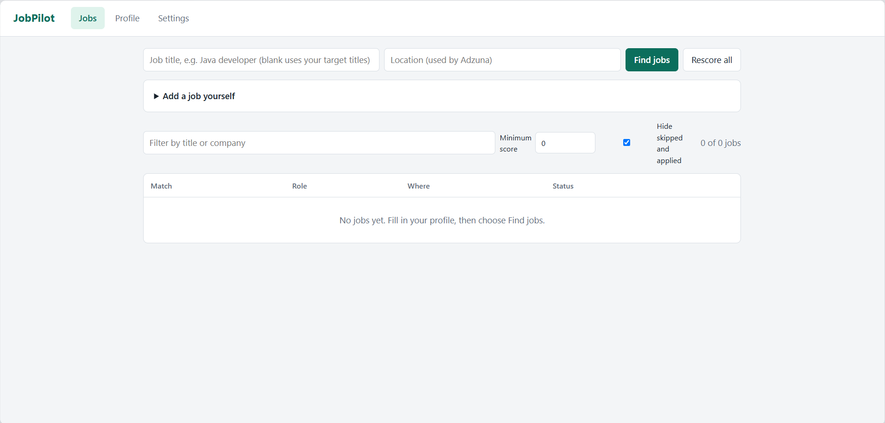
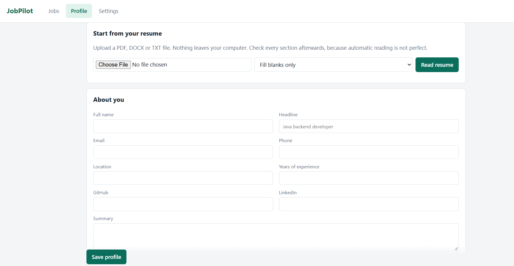
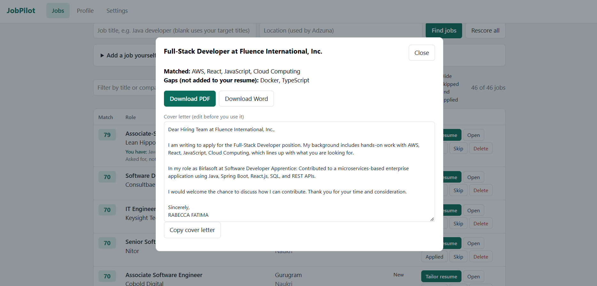
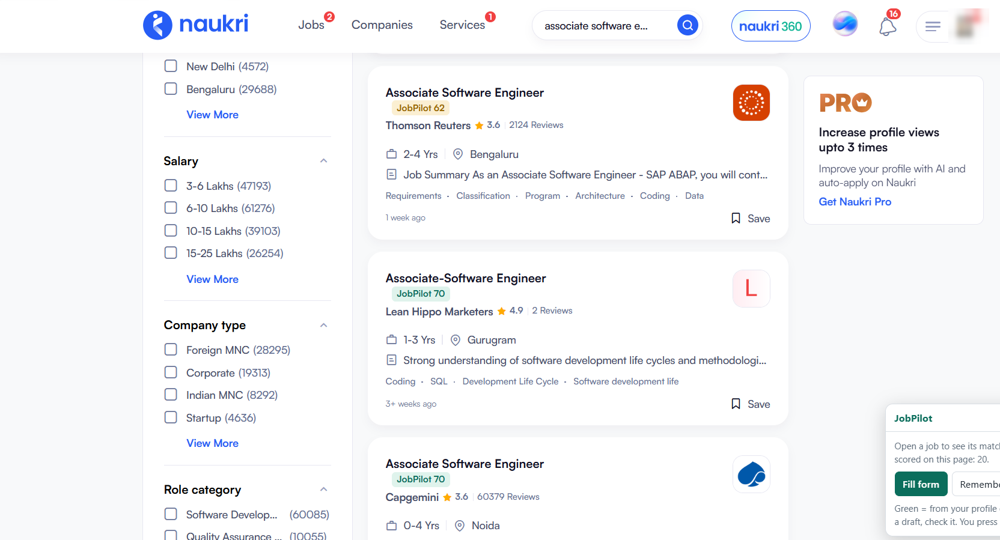
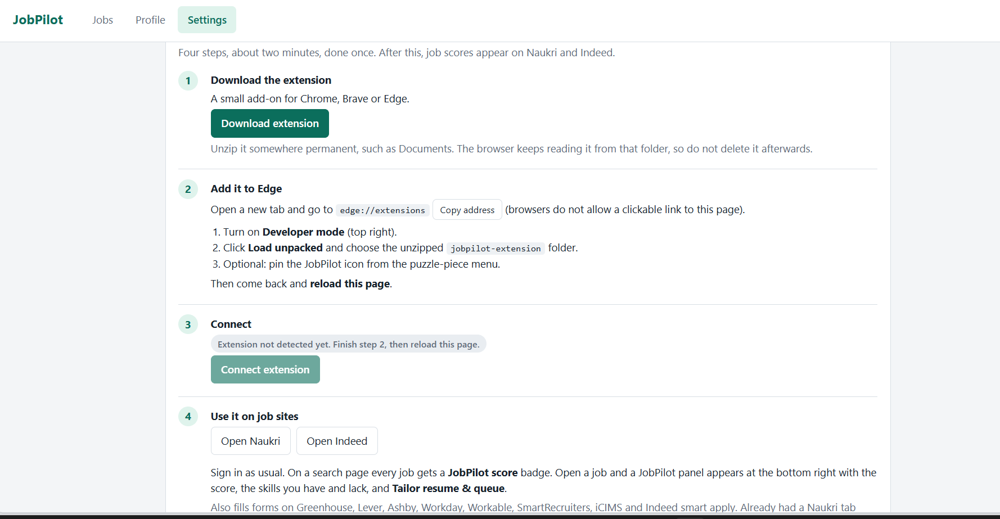

# JobPilot (Spring Boot)

A local-first job search assistant built with **Java 17 and Spring Boot**. It turns your resume into a profile, scores job postings against your skills, builds a tailored resume and cover letter for each job, and fills application forms through a Chrome-family browser extension. Everything runs on your own computer, and you press Submit yourself.

## Screenshots

**Jobs: find jobs, filter, score and tailor**



**Profile: start from your resume, then review every section**



**Tailored resume and cover letter for one job** (download PDF or Word, edit the letter before you use it)



**Scores on Naukri** (a JobPilot badge on every listing, plus a panel at the bottom right)



**Settings: a four-step guide to connect your browser**



## Features

- **Resume import:** upload a PDF, DOCX or TXT resume and get an editable profile (skills, roles, projects, education).
- **Job collection:** pull remote jobs from Remotive (no key), Adzuna (free key, many Indian listings), or paste any posting yourself.
- **Match score (0 to 100):** skills 55, title 20, experience 15, location 10, with the skills you have and the skills the job asks for that are missing from your profile.
- **Tailored resume and cover letter:** PDF and Word output. It only selects and reorders what is already on your profile and never adds skills you do not have. Missing skills are shown as gaps.
- **Browser extension:** score badges on Naukri and Indeed, a panel on job pages, an apply queue, and form autofill (green = filled from your profile or saved answers, amber = a draft to check).
- **Saved answers:** answers you type on forms are remembered when you press Applied and reused next time. Sensitive fields are never saved.
- **Optional AI drafts:** short answers to free-text questions, using the Claude API when you set a key.

## How it works

```
Browser extension / web UI  ->  Controller  ->  Service  ->  Repository  ->  H2 database
```

Layers: `model` (Profile), `entity` (Job, ProfileEntity, SavedAnswer), `repo` (Spring Data JPA), `service` (import, matching, tailoring, rendering), `web` (REST controllers, security filter, error handler).

## Tech stack

| Part | Technology |
|---|---|
| Language and framework | Java 17, Spring Boot 3.3 (Web, Data JPA) |
| Database | H2 (file database in `./data`) |
| Resume reading | Apache PDFBox (PDF), Apache POI (DOCX) |
| Resume writing | OpenPDF (PDF), Apache POI (Word) |
| HTTP client | Spring `RestClient` (Remotive, Adzuna, optional Claude API) |
| UI | Plain HTML, CSS and JavaScript served by Spring |
| Extension | Manifest V3 (service worker plus content scripts) |
| Build | Maven, Lombok |

## Requirements

- JDK 17 or 21 (newer versions can break Lombok)
- Maven 3.9+ (or use IntelliJ IDEA, which bundles Maven)
- Chrome, Brave or Edge for the extension

## Quick start

```bash
git clone https://github.com/Skyler01-collab/jobpilot-java.git
cd jobpilot-java
mvn spring-boot:run
```

The first run downloads dependencies and can take a few minutes. When you see `Started JobPilotApplication`, open **http://127.0.0.1:8765**.

**IntelliJ IDEA:** File > Open > select `pom.xml` > Open as Project, wait for the Maven import, open `JobPilotApplication.java` and click Run. Enable annotation processing if IntelliJ asks (Lombok).

## First use

1. **Profile tab:** upload your resume, review every section, then click **Save profile**.
2. **Jobs tab:** click **Find jobs**, or open "Add a job yourself" and paste a posting.
3. Click **Tailor resume** on a job to get the PDF, the Word file and a draft cover letter.

## Connect the browser extension

Open the **Settings** tab. It walks you through four steps:

1. **Download the extension** (a zip served by the app) and unzip it somewhere permanent.
2. Open your browser's extensions page (`chrome://extensions`, `brave://extensions` or `edge://extensions`), turn on Developer mode, click **Load unpacked** and choose the `jobpilot-extension` folder. Reload the JobPilot page.
3. Press **Connect extension**. One click pairs it with the app.
4. Open Naukri or Indeed. Search results get a JobPilot score badge, and job pages get a panel with the score.

Prefer manual setup? Use "Connect manually" on the Settings page and copy the server address and token into the extension popup.

| Where | What happens |
|---|---|
| Naukri / Indeed search results | Each listing is saved and gets a JobPilot score badge |
| Naukri / Indeed job page | Full description is saved. A panel shows the score, with Tailor resume & queue and I applied |
| Apply queue (popup > Start apply queue) | Opens each queued job, highlights Apply (clicks it only if you turn that on), fills the form, attaches the tailored PDF, fills cover-letter boxes and notices the "application submitted" message |
| Greenhouse, Lever, Ashby, Workday, Workable, SmartRecruiters, iCIMS, Indeed smart apply | Form autofill plus a small panel |
| Any other page | Popup > Fill this form, or Save this page as a job |

The extension never presses the final **Submit** button. Passwords, ID numbers and sensitive questions (gender, ethnicity, disability and similar) are never filled or saved.

## Optional settings

Set these as environment variables before starting the app (Windows: `set NAME=value`).

| Variable | Purpose |
|---|---|
| `ADZUNA_APP_ID`, `ADZUNA_APP_KEY` | Free keys from [developer.adzuna.com](https://developer.adzuna.com) for more job listings |
| `ANTHROPIC_API_KEY` | Turns on AI drafts for free-text application questions. Your profile and the job text are sent to Anthropic for each draft |

Port and other options live in `src/main/resources/application.properties`. If you change the port, also update the two `127.0.0.1:8765` / `localhost:8765` entries in the extension's `manifest.json`.

## Security and privacy

- The server listens on `127.0.0.1` only, so other devices cannot reach it.
- Every state-changing API call must carry an `X-JobPilot` header. Browsers do not let other websites send it cross-origin, which blocks cross-site request forgery.
- CORS allows only the extension and the app's own origin.
- The extension pairs with a random token (24 bytes from `SecureRandom`, compared in constant time). You can regenerate it in Settings.
- Database queries are parameterised through JPA, and the UI escapes all text it shows.
- Your data (database, generated resumes, token) stays in `./data` and is excluded from Git.
- API keys are read from environment variables, never from code.

This is a single-user local tool. For a hosted, multi-user version you would add Spring Security with proper login, HTTPS and an encrypted database.

## Project structure

```
src/main/java/com/jobpilot
  model/    Profile, TailoredResume
  entity/   Job, ProfileEntity, SavedAnswer
  repo/     Spring Data repositories
  service/  ResumeImportService, MatchService, TailorService, ResumeRenderer,
            JobService, JobSourceClient, SkillTaxonomy, AiService, SettingsService
  web/      Controllers, ApiHeaderFilter, WebConfig, ApiExceptionHandler
src/main/resources/static       the web UI
src/main/resources/extension    the Chrome extension (offered as a download in Settings)
docs/screenshots                images used in this README
```

## REST API

```
GET/PUT  /api/profile
POST     /api/profile/import              multipart "file", mode=merge|replace
GET      /api/jobs                        POST /api/jobs   POST /api/jobs/fetch   POST /api/jobs/rescore
PATCH    /api/jobs/{id}/status?value=APPLIED|SKIPPED|QUEUED|NEW
POST     /api/jobs/{id}/tailor
GET      /api/jobs/{id}/resume.pdf | resume.docx | cover-letter.txt
GET/PUT/DELETE /api/answers
GET      /api/settings                    POST /api/settings/token/regenerate
POST     /api/ext/capture                 POST /api/ai/answer
```

Add the header `X-JobPilot: 1` to every POST, PUT, PATCH and DELETE when testing with Postman or Insomnia.

## Troubleshooting

- **`mvn` is not recognized:** install Maven and reopen the terminal, or use IntelliJ.
- **Build fails with a Lombok or "release version" error:** use JDK 17 or 21.
- **`NoClassDefFoundError` for a Word class:** make sure `pom.xml` uses `poi-ooxml-full` (already configured), then reload Maven.
- **Settings page is blank or old:** stop the app, rebuild, and hard-refresh the browser (Ctrl+F5).
- **No score on Naukri or Indeed:** check the JobPilot panel at the bottom right of the page. It says why (for example "Not connected"). Reload the job site tab after connecting.
- **Port already in use:** change `server.port` in `application.properties`.
- **"No text could be read" on import:** the PDF is a scan. Use the DOCX or TXT version.

## Limitations

- Naukri and Indeed change their page layouts often. The selectors are at the top of `extension/site.js` and may need adjusting.
- The resume parser is rule-based, not AI, so always review the imported profile.
- Naukri and Indeed may restrict automated use of their sites. Use the extension with your own account and at your own risk. This project is not affiliated with Naukri, Indeed or any other job site.

## Author

Built by Rabecca Fatima.
